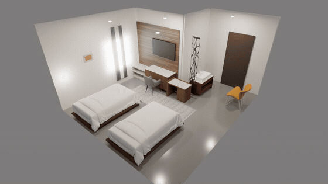

# Foto a cuarto 3D

Convierte fotos o un video corto de un cuarto en un **plano con medidas** y una **escena 3D que puedes recorrer**. Todo corre en tu propia tarjeta de video, con ComfyUI y Blender.

**Qué hace:**

1. Encuentra el piso, las paredes y el techo, y calcula la profundidad de cada punto de la foto.
2. Recorta, nombra y mide cada mueble, y calcula hacia dónde mira.
3. Dibuja el plano visto desde arriba, con medidas y distancias. Con una medida real se corrige la escala de todo el plano.
4. Arma la escena 3D en Blender, con la misma cámara que la foto.
5. Junta varias fotos o cuadros de un video en un solo cuarto.

**Qué trae:**

- **`pipeline/`:** los scripts.
- **`viewer/`:** el visor con tres cuartos de ejemplo. Ábrelo con `serve.bat`.
- **`demo/`:** el demo paso a paso.

**Los pesos de los modelos no vienen incluidos.** Cada quien los descarga de su página oficial.

Las instrucciones completas, la configuración y las limitaciones están en el [README en inglés](README.md). Las licencias de cada modelo están en [MODELS.md](MODELS.md); algunas no permiten uso comercial.

El código es **GPL-3.0**.
