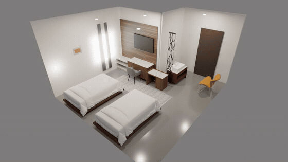
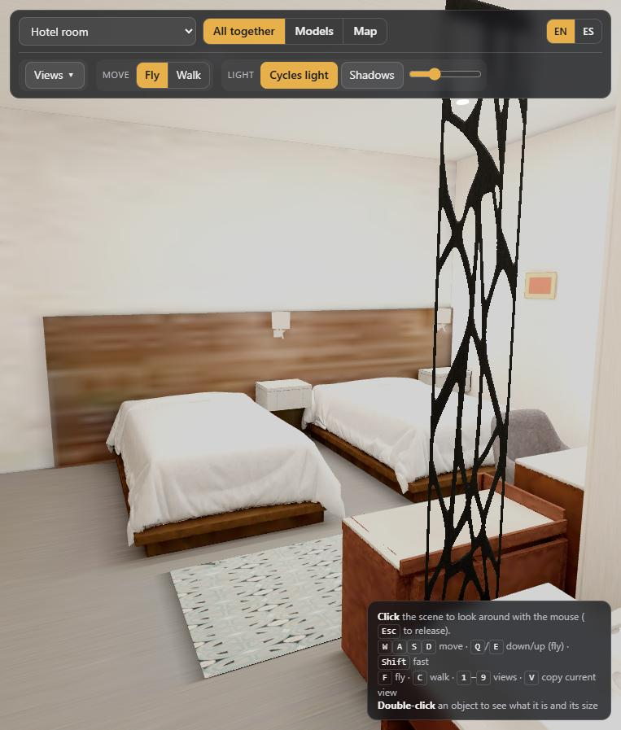
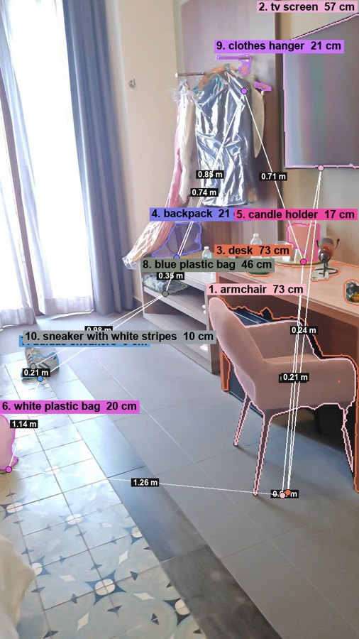

# Photo to 3D room

Turn ordinary photos or a short video of a room into a **measured floor plan** and a **walkable 3D scene**, running entirely on your own GPU with ComfyUI and Blender.

*[Leer en español](README.es.md)*





What it does, step by step:

1. **Reads the room.** It finds the floor, walls and ceiling (SAM 3.1), then the depth of every pixel (MoGe-2), and from that the camera height and the room orientation.
2. **Finds and measures every object.** Each piece of furniture is cut out, named by a vision-language model (Qwen3-VL), and gets a size in metres, a position and the direction it faces.
3. **Draws a plan.** It produces a top-down plan with sizes, distances and a 1 m ruler. One real measurement (for example "the table is 1.40 m wide") fixes the scale of the whole map.
4. **Builds the 3D scene.** Every object becomes a 3D model, either a match from a local gallery or generated with TRELLIS.2. Blender places it with the same camera as the photo, so you can check the result over the original.
5. **Joins several photos or video frames** into one room (`align_photos.py`, or the LingBot-Map / MapAnything aligners).

## What is in this repository

| Folder | What it is |
|---|---|
| `pipeline/` | The Python scripts. The entry point is `photo_to_map.py`; `CONVENTIONS.md` documents every output file and JSON key. |
| `viewer/` | A static three.js viewer (English and Spanish) with three example rooms. You can fly or walk through them, open each 3D model separately, and see the plans. |
| `demo/` | A step-by-step web demo of the process (UI in English). It replays a precomputed hotel-room example and does not process your own video. |

**Model weights are not included.** Download each model from its official page and accept its licence (see [MODELS.md](MODELS.md)).

## Requirements

- Windows 10/11 and an NVIDIA GPU. It was developed on an RTX 4090 (24 GB); smaller cards may need lower settings.
- [ComfyUI Desktop](https://www.comfy.org/download), with the models listed in [MODELS.md](MODELS.md) in its `models` folder. The main pipeline uses only core ComfyUI nodes. The optional mesh refinement (`refine_hi3d.py`) also needs the Hi3D custom nodes.
- [Blender 5.x](https://www.blender.org/download/) for the 3D scene.
- Python 3.11+ with `numpy`, `Pillow` and `scipy`. The ComfyUI Desktop python already has them.

## Quick start

```powershell
# 1. start ComfyUI (it listens on port 8188 by default)
# 2. run the pipeline on the example photo (about a minute on an RTX 4090)
& "$env:LOCALAPPDATA\Comfy-Desktop\ComfyUI-Installs\ComfyUI\standalone-env\python.exe" -I pipeline\photo_to_map.py examples\hotel_room.jpg out\hotel_room --symbolic
# 3. optional: fix the scale with one real measurement
#    (here object 3, the desk, is 0.75 m tall; check the numbers in guides.png first, they can change between runs)
& "$env:LOCALAPPDATA\Comfy-Desktop\ComfyUI-Installs\ComfyUI\standalone-env\python.exe" -I pipeline\photo_to_map.py out\hotel_room --measure "3=0.75"
```

Open `out\hotel_room\plan.png` and `guides.png` to see the result. This is what the example gives:

| Objects found and measured | Top-down plan |
|---|---|
|  |  |

The desk comes out at 73 cm tall and the armchair at 73 cm, without any measurement given. It also finds small things like the sneakers and the bags on the floor. Remove `--symbolic` to generate real 3D models instead of boxes; this is slower, about a minute per object.

Optional models are used only when they are installed. Without Orient Anything V2 (`ORIENT_ANYTHING_DIR`), the direction each object faces comes from the geometry. Without a gallery (`GALLERY_DIR`), every object is generated with TRELLIS.2.

### See the examples

Double-click `viewer\serve.bat` (or run `python -m http.server 8765` inside `viewer\`) and open http://localhost:8765. Do the same in `demo\` for the step-by-step demo. Opening `index.html` directly with `file://` does not work, because browsers block loading the models.

## Configuration

The defaults match a standard ComfyUI Desktop install on Windows. Override them with environment variables:

| Variable | Used by | Default |
|---|---|---|
| `COMFY_OUTPUT_DIR` | all ComfyUI calls | `%LOCALAPPDATA%\Comfy-Desktop\ComfyUI-Shared\output` |
| `COMFY_OUTPUT_DIRS` | several ComfyUI instances, as JSON `{"8188": "...", "8190": "..."}` | — |
| `COMFY_INPUT_DIR` | `refine_hi3d.py` | `%LOCALAPPDATA%\Comfy-Desktop\ComfyUI-Shared\input` |
| `COMFY_DIR`, `DINO_WEIGHTS` | `fingerprints.py` (gallery matching) | ComfyUI Desktop paths |
| `COMFY_PYTHON`, `COMFY_VENV_PYTHON` | `photo_to_map.py` | ComfyUI Desktop pythons |
| `BLENDER` | `photo_to_map.py` | `C:\Program Files\Blender Foundation\Blender 5.3\blender.exe` |
| `GALLERY_DIR` | gallery matching | `gallery\` next to `pipeline\` (not included; optional) |
| `ORIENT_ANYTHING_DIR` | `orientation.py`, `vggt_align.py` (optional; non-commercial) | `orient-anything-v2` |
| `SPATIALLM_DIR` | `run_spatiallm.py` (optional) | `spatiallm` |
| `LINGBOT_DIR`, `LINGBOT_WEIGHTS`, `LINGBOT_PYTHON`, `MAPANYTHING_PYTHON` | multi-view aligners (optional) | — |

## Honest limitations

- **Joining many photos is still rough.** Each photo on its own gives a good plan, but merging several can duplicate furniture or misplace it. Treat the merged plan as a draft.
- **Object names come from a VLM** and are sometimes wrong (for example "broken furniture pieces" for a chair seen from behind).
- **Scale is estimated from depth** and can be off by several percent. Give one real measurement with `--measure` when accuracy matters.
- Generated 3D models are good for layout and visualisation, not for manufacturing.
- Tested only on Windows with one GPU. Paths and launchers assume ComfyUI Desktop.

## Licence

The code in this repository is released under the **GNU GPL v3.0** (see [LICENSE](LICENSE)). Several scripts run inside Blender and use its GPL Python API.

The example rooms in `viewer/` and `demo/` (3D models, plans and video frames) may be used for testing and demonstration of this project.

**Model licences are separate and some are non-commercial.** Qwen-Image 2.1, Orient Anything V2 and SpatialLM do not allow commercial use. Read [MODELS.md](MODELS.md) before using the output in a paid product.

Built with DINOv3. See [MODELS.md](MODELS.md) for all credits.
