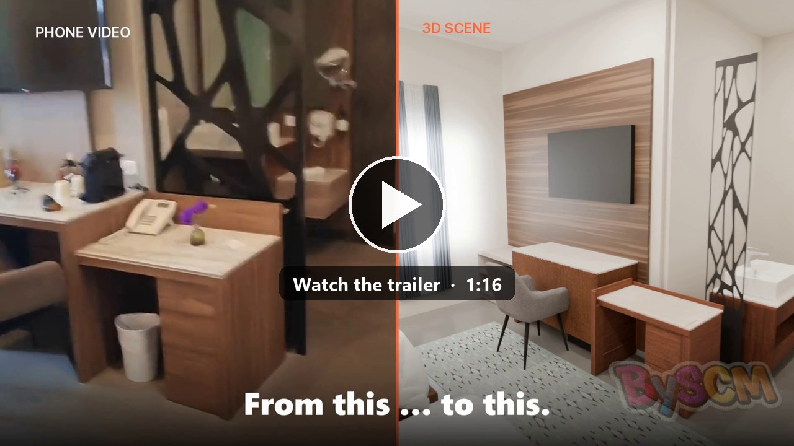
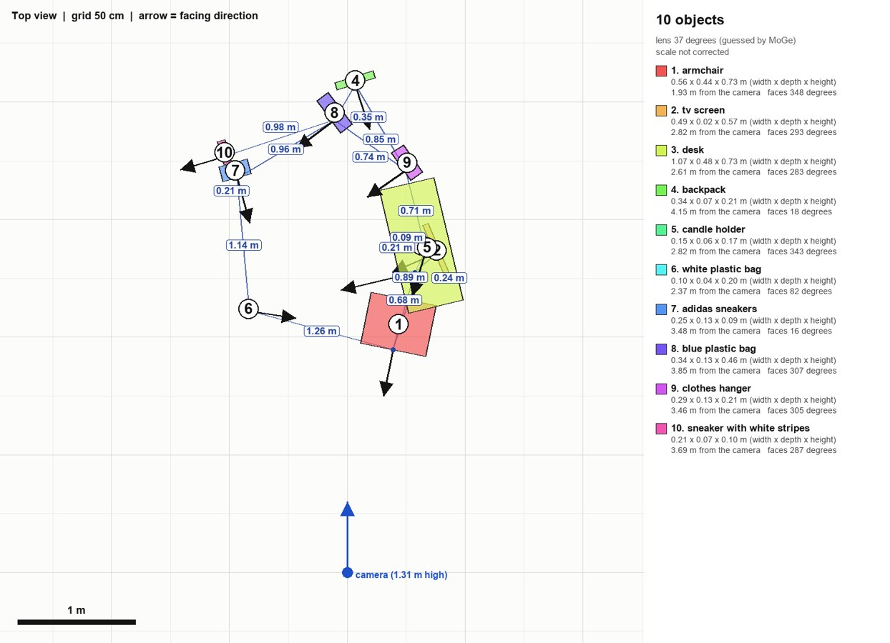

# Mole Poblano

**Photo to 3D room.** Turn ordinary photos or a short video of a room into a **measured floor plan** and a **walkable 3D scene**, running entirely on your own GPU with ComfyUI and Blender.

*[Leer en español](README.es.md)*

[](https://youtu.be/cJ_rc77GipY)


What it does, step by step:

1. **Reads the room.** It finds the floor, walls and ceiling (SAM 3.1), then the depth of every pixel (MoGe-2), and from that the camera height and the room orientation.
2. **Finds and measures every object.** Each piece of furniture is cut out, named by a vision-language model (Qwen3-VL), and gets a size in metres, a position and the direction it faces.
3. **Draws a plan.** It produces a top-down plan with sizes, distances and a 1 m ruler. One real measurement (for example "the table is 1.40 m wide") fixes the scale of the whole map.
4. **Builds the 3D scene.** Every object becomes a 3D model, either a match from a local gallery or generated with TRELLIS.2. Blender places it with the same camera as the photo, so you can check the result over the original.
5. **Joins several photos or video frames** into one room (`align_photos.py`, or the LingBot-Map / MapAnything aligners).

## What goes in, what comes out

Each example room started as a quick phone recording, the kind anyone can make in a minute. The original recordings are in `examples/`, compressed and without audio, so you can see exactly what the pipeline was given:

| Room | What went in | What came out |
|---|---|---|
| Hotel room | Two phone videos of about 30 s ([part 1](examples/source_videos/hotel_part1.mp4), [part 2](examples/source_videos/hotel_part2.mp4)) | [Viewer](viewer/?cuarto=hotel), [demo](demo/) |
| Dining room and kitchen | Four short clips sent over a messaging app, joined in [one video](examples/source_videos/dining_kitchen.mp4) | [Viewer](viewer/?cuarto=casa_comedor) |
| Bedroom with walk-in closet | [Eight photos](examples/source_photos_bedroom/) taken from a video | [Viewer](viewer/?cuarto=cuarto) |

## What is in this repository

| Folder | What it is |
|---|---|
| `pipeline/` | The Python scripts. The entry point is `photo_to_map.py`; `CONVENTIONS.md` documents every output file and JSON key. |
| `viewer/` | A static three.js viewer (English and Spanish) with three example rooms. You can fly or walk through them, open each 3D model separately, and see the plans. |
| `demo/` | A step-by-step web demo of the process (UI in English). It replays a precomputed hotel-room example and does not process your own video. |

**Model weights are not included.** Download each model from its official page and accept its licence (see [MODELS.md](MODELS.md)).

## Requirements

- Windows 10/11 and an NVIDIA GPU. It was developed on an RTX 4090 (24 GB); smaller cards may need lower settings.
- [ComfyUI Desktop](https://www.comfy.org/download), with the models listed in [MODELS.md](MODELS.md) in its `models` folder. The main pipeline uses only core ComfyUI nodes. The optional mesh refinement (`refine_hi3d.py`) also needs the Hi3D custom nodes.
- [Blender 5.x](https://www.blender.org/download/) for the 3D scene.
- Python 3.11+ with `numpy`, `Pillow` and `scipy`. The ComfyUI Desktop python already has them.

## Quick start

```powershell
# 1. start ComfyUI (it listens on port 8188 by default)
# 2. run the pipeline on the example photo (about a minute on an RTX 4090)
& "$env:LOCALAPPDATA\Comfy-Desktop\ComfyUI-Installs\ComfyUI\standalone-env\python.exe" -I pipeline\photo_to_map.py examples\hotel_room.jpg out\hotel_room --symbolic
# 3. optional: fix the scale with one real measurement
#    (here object 3, the desk, is 0.75 m tall; check the numbers in guides.png first, they can change between runs)
& "$env:LOCALAPPDATA\Comfy-Desktop\ComfyUI-Installs\ComfyUI\standalone-env\python.exe" -I pipeline\photo_to_map.py out\hotel_room --measure "3=0.75"
```

Open `out\hotel_room\plan.png` and `guides.png` to see the result. This is what the example gives:

| Objects found and measured | Top-down plan |
|---|---|
|  |  |

The desk comes out at 73 cm tall and the armchair at 73 cm, without any measurement given. It also finds small things like the sneakers and the bags on the floor. Remove `--symbolic` to generate real 3D models instead of boxes; this is slower, about a minute per object.

Optional models are used only when they are installed. Without Orient Anything V2 (`ORIENT_ANYTHING_DIR`), the direction each object faces comes from the geometry. Without a gallery (`GALLERY_DIR`), every object is generated with TRELLIS.2.

### See the examples

Double-click `viewer\serve.bat` (or run `python -m http.server 8765` inside `viewer\`) and open http://localhost:8765. Do the same in `demo\` for the step-by-step demo. Opening `index.html` directly with `file://` does not work, because browsers block loading the models.

## Configuration

The defaults match a standard ComfyUI Desktop install on Windows. Override them with environment variables:

| Variable | Used by | Default |
|---|---|---|
| `COMFY_OUTPUT_DIR` | all ComfyUI calls | `%LOCALAPPDATA%\Comfy-Desktop\ComfyUI-Shared\output` |
| `COMFY_OUTPUT_DIRS` | several ComfyUI instances, as JSON `{"8188": "...", "8190": "..."}` | — |
| `COMFY_INPUT_DIR` | `refine_hi3d.py` | `%LOCALAPPDATA%\Comfy-Desktop\ComfyUI-Shared\input` |
| `COMFY_DIR`, `DINO_WEIGHTS` | `fingerprints.py` (gallery matching) | ComfyUI Desktop paths |
| `COMFY_PYTHON`, `COMFY_VENV_PYTHON` | `photo_to_map.py` | ComfyUI Desktop pythons |
| `BLENDER` | `photo_to_map.py` | `C:\Program Files\Blender Foundation\Blender 5.3\blender.exe` |
| `GALLERY_DIR` | gallery matching | `gallery\` next to `pipeline\` (not included; optional) |
| `ORIENT_ANYTHING_DIR` | `orientation.py`, `vggt_align.py` (optional; non-commercial) | `orient-anything-v2` |
| `SPATIALLM_DIR` | `run_spatiallm.py` (optional) | `spatiallm` |
| `LINGBOT_DIR`, `LINGBOT_WEIGHTS`, `LINGBOT_PYTHON`, `MAPANYTHING_PYTHON` | multi-view aligners (optional) | — |

## Honest limitations

- **Joining many photos is still rough.** Each photo on its own gives a good plan, but merging several can duplicate furniture or misplace it. Treat the merged plan as a draft.
- **Object names come from a VLM** and are sometimes wrong (for example "broken furniture pieces" for a chair seen from behind).
- **Scale is estimated from depth** and can be off by several percent. Give one real measurement with `--measure` when accuracy matters.
- Generated 3D models are good for layout and visualisation, not for manufacturing.
- Tested only on Windows with one GPU. Paths and launchers assume ComfyUI Desktop.

## How the example rooms were made

The pipeline gives the plan, the measurements and a 3D model of each object. The three rooms in `viewer/` and the hotel in the GIF above **went further than that**: each one also got a finishing pass done room by room with extra scripts and manual decisions that are not part of this repository. That pass cleaned up the merged plan, fixed furniture that overlapped or crossed walls, chose materials, and baked the lighting in Blender.

So expect the pipeline to give you a solid draft, not the finished look of the examples. Automating that finishing pass is the next step on the roadmap.

## Polish a draft with your own AI agent

The whole room lives in one file, `out/<room>/map.json`, and `pipeline/CONVENTIONS.md` documents every key. If you use a coding agent with your own account (Claude Code, Cursor, Codex, Antigravity…), open the Mole Poblano folder with it and ask for changes in plain language, for example: *"in out/hotel_room, move the armchair 20 cm to the left, make the desk 75 cm tall and rebuild the scene"*.

The agent picks up its instructions from [AGENTS.md](AGENTS.md): the coordinate system, which edits the 3D scene honours, and the one command that rebuilds everything in a few seconds:

```powershell
& "$env:LOCALAPPDATA\Comfy-Desktop\ComfyUI-Installs\ComfyUI\standalone-env\python.exe" -I pipeline\rebuild.py out\hotel_room
```

You can also edit `map.json` by hand and run the same command. This repository ships no keys or subscriptions: the agent and its cost are yours, and everything else still runs on your machine.

## How this was built

I designed this project, chose the models, tested it against real measurements and used it with real clients. I wrote the code with **Claude Code** as an AI coding assistant, which is why some commits carry a `Co-Authored-By: Claude` line.

## Licence

The code in this repository is released under the **GNU GPL v3.0** (see [LICENSE](LICENSE)). Several scripts run inside Blender and use its GPL Python API.

The example rooms in `viewer/`, `demo/`, `examples/` and `docs/img/` (3D models, plans, photos, video frames and renders) are licensed under **[Creative Commons Attribution 4.0 (CC BY 4.0)](https://creativecommons.org/licenses/by/4.0/)**: you can use them for anything, including commercial work, as long as you credit "BySCM – Mole Poblano".

**Model licences are separate and some are non-commercial.** Qwen-Image 2.1, Orient Anything V2 and SpatialLM do not allow commercial use. Read [MODELS.md](MODELS.md) before using the output in a paid product.

Built with DINOv3. See [MODELS.md](MODELS.md) for all credits.
